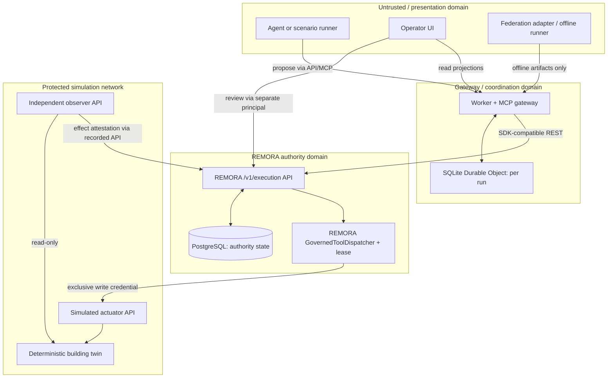

# SDD-OT-001 — Autonomous OT Control
## Minimal digital twin, REMORA-governed dispatcher, Cloudflare and federation testbed

| Metadata | Value |
|---|---|
| Document | `SDD-OT-001` |
| Version | **1.0 — implementation specification (PROPOSED)** |
| Date | 2026-10-26 |
| Target repository | `https://github.com/darklordVirtual/autonomous-ot-control` |
| Source repository | `https://github.com/darklordVirtual/REMORA-research` |
| REMORA observed baseline | `2594d08b592e61f3d0f436671a230faaa311db9a` (2026-10-26) |
| Owner | Repository owner; architecture and safety decisions must be approved before physical OT writes |
| Initial release | `SIMULATED_CONTROLLED_PILOT` — simulator only |
| Federation | `https://github.com/aeoess/agent-governance-vocabulary/issues/177` |
| Status | **Design, not implementation or a claim of deployed safety** |

> **Scope rule:** Build the smallest independently reproducible digital-twin OT demonstration in which an agent proposes a bounded temperature-setpoint action, REMORA authorizes or refuses it, a protected dispatcher sends it to a simulation endpoint, and a distinct observation reader checks its actual effect. No new authorization engine, duplicate dispatcher, replacement REMORA SDK, or general BMS framework.

## 0. Evidence baseline and decision context

**Verified from repositories on 2026-10-26:**

- `autonomous-ot-control` is a public, empty GitHub repository: no initial commit or code was present when inspected. Nothing described in this SDD is represented as already implemented there.
- REMORA's supported third-party Python import surface is `remora.sdk`; `docs/sdk.md` explicitly calls it the *client* to the versioned `/v1/execution` REST service. It does not hold the external tool's credentials and is not a policy-enforcement engine.
- REMORA's dispatcher (`GovernedToolDispatcher`) and `ExecutionLease` are internal enforcement-side mechanisms. They remain in REMORA, not copied or reimplemented in this repository.
- Existing demonstration components are `deploy/ot-pilot/ot_registry.py`, `ot_bundle.py`, `run_ot_battery.py`, `run_fault_injection.py` and a Docker Compose stack. The current simulator keeps the plant in Python memory: it is a useful **regression reference**, not a physics-based building twin.
- The existing OT deployment is one host/one API replica with local SQLite cumulative-limit ledger and PostgreSQL for durable execution state. This does **not** establish safe distributed, multi-replica execution.
- On the examined baseline, PR #1084 (flow sequence/fence race) and #1085 are open. Do not implement their internals here; avoid enabling dependent flow-control claims until upstream fixes are reviewed and verified.
- REMORA release profile `CONTROLLED_PILOT` is an owner-authorized readiness designation, not proof that a given installation is safe or that physical OT control is approved.
- `docs/validation/pilot_evaluation_protocol_v1.md` (PROPOSED) currently excludes inline physical OT/BMS control absent a separate hazard analysis, independent interlocks, safe-state recovery and change control. This SDD respects that boundary: simulation comes first.

**Cloudflare documentation facts, verified 2026-10-26:**

- Wrangler local development uses Miniflare/workerd; Miniflare is **not** a hardened sandbox for untrusted code.
- SQLite-backed Durable Objects offer private, transactional storage per object; one object does not supply cross-object or REMORA-PostgreSQL atomic transactions.
- Durable Object alarms are *at-least-once*, can retry, and must not constitute authority or trigger a duplicate effect.
- New Wrangler projects should use `wrangler.jsonc`; new Durable Object namespaces should be SQLite-backed. Current configuration supports `exports`-based SQLite Durable Objects; don't mix exports and legacy migrations in one Worker.
- Cloudflare Containers can run custom Docker workloads coupled to a Durable Object. They require the appropriate Cloudflare plan, and Docker-local parity is not proof of hosted behavior.

**Design assumptions that require verification:** availability of a live WebPort API, a particular SDK release/publish channel, accessible Cloudflare paid deployment, energy-model calibration, participant permissions and any external federation integration. No claim is made that those are in place today.

## 1. Goals, non-goals and explicit finish line

### G1 — Minimal useful demonstration

The system simulates one building with three thermal zones and a deterministic clock. One agent proposes `set_zone_setpoint` for one zone. REMORA alone determines authority, checks a signed deployment-owned tool contract, obtains human approval where required, dispatches through its protected execution path, and records outcome. A separate observation component measures the resulting plant state. The simulator is intentionally **not** a building safety controller.

### G2 — Reproducible comparison

Evaluate a bounded optimization strategy against a fixed rule-based baseline under identical weather, occupancy, initial conditions, random seed and simulated time. Report energy **estimate**, comfort violations, command frequency, and simulated cost with exact denominators. Never call this verified real-building savings.

### G3 — Two realistic runtime backends and one hosted path

1. **Docker-only**: offline, fully reproducible, no paid infrastructure or Cloudflare account.
2. **Miniflare**: Wrangler-hosted Worker and local Durable Objects, paired with Docker REMORA/plant via developer-accessible endpoints; all test effects remain in the simulator.
3. **Cloudflare**: Worker + SQLite Durable Object in staging, talking to an approved REMORA execution service (container or managed endpoint) with a durable PostgreSQL domain. A Cloudflare Container deployment path may be added behind an opt-in profile after its runtime semantics are measured.

### G4 — Federation invitation without surrendering control

Issue #177 participants can build small adapters, provide vectors, review result-evidence binding, run offline reproductions and publish independent findings. Participants never receive production keys, real tenant datasets, true building connectivity, or unilateral authority to dispatch.

### Non-goals for v1

- A complete WebPort client, live BMS actuation, AHU/valve control, automatic pricing engine, advanced HVAC model predictive control, BIM rendering or proprietary facility-management database.
- Duplication of REMORA's `remora/enforcement/`, `remora/policy/`, `servers/execution_api.py`, capability registers or SDK implementation.
- Deploying a second authorization service in TypeScript or in Durable Objects.
- Embedding LangGraph or any specific agent framework in core runtime.
- Multi-replica effect dispatch, cross-object transactions, autonomous real-building writes, auto-merge of community code, or externally verified maturity claims.

**MVP completion definition:** A fresh contributor runs one documented Docker command and one smoke-test command; observes an authorized, correctly bounded simulated setpoint action, sees an unauthorized request refused with no plant effect, verifies the approved action's simulated postcondition, and exports a reproducible evidence bundle. The same exact contract tests pass through a Miniflare front end. This is *enough to demonstrate the product concept*, not to authorize physical actuation.

## 2. Threat model and trust domains

### Actors and trust classes

| Actor | Trust posture | Permitted operations |
|---|---|---|
| AI agent | Untrusted decision proposer | Read allowed public/simulated measurements and submit exact proposals; no approval credential, no plant network route |
| External federation participant | Untrusted code/contributor | Offline, fake-data adapters and vectors in isolated container/VM; cannot reach live control networks |
| Worker / MCP gateway | Authenticated transport, **not** source of authority | Authenticate caller, tenant mapping, route requests, present status; never approve or dispatch by itself |
| Per-run Durable Object | Coordination and state projection | Persist run metadata, ordered job IDs, progress and snapshot references; cannot grant tool authority |
| REMORA control plane | Authoritative policy/gate and lifecycle | Resolve server-owned contracts, policy, roles, grants, leases, dispatch records and evidence |
| Protected REMORA dispatcher | Sole path with actuator access | Redeem single-use grant, validate exact call, execute deployment-owned registered callable |
| Simulator control endpoint | Protected simulated effect target | Accept commands only from the dispatcher trust domain; reject any request lacking service identity |
| Independent observation endpoint | Separate read credentials/path | Read simulator state and attested history; cannot command plant, cannot edit authorized call record |
| Human reviewer | Separate principal | Approve/reject applicable proposals, never share agent credential |

### Security invariants (normative)

- **INV-01 No bypass:** The agent, Worker, Durable Object, optimization process, dashboard and federation runners cannot connect to the simulator's **write endpoint**. Only the credential-holding REMORA dispatcher runtime can. Network reachability *and* authentication must independently enforce this.
- **INV-02 Custody:** Plant-write credentials are mounted only into the protected dispatcher/runtime. SDK clients are read/propose only, except that a role-restricted operator SDK client can redeem via REMORA's own API. Never export credentials to agent prompts, JS bundles, environment files committed to Git or participant images.
- **INV-03 Bound call:** Tenant, principal, signed ToolSpec, tool name, immutable canonical arguments, intent/work-order identity, policy version and applicable lease/grant identity are bound by REMORA. The simulator does not trust caller-supplied authority labels.
- **INV-04 Single-use:** An approval, lease or client request replay must not create a second effect. A stable operation/idempotency identity must be meaningful in the protected execution domain, not merely a duplicate-check in a DO.
- **INV-05 Fail closed:** Denial, unknown tool, missing signed limits, stale sensor evidence, unavailable durable authority store or out-of-policy argument means zero new dispatch. `UNKNOWN` means no automatic retry of the side effect.
- **INV-06 Separation:** The proposing identity cannot self-approve; external observation cannot authorise or modify dispatch; evidence writer cannot rewrite historic decision.
- **INV-07 Safety priority:** Hard bounds and change-rate limits outrank any optimization score. Simulated local interlocks refuse invalid/out-of-range effects even if middleware is compromised. In a future real site, independent field safety systems are mandatory.
- **INV-08 Provenance:** Exported test evidence pins git SHA, image digest, policy/ToolSpec digest, seed, simulation time range, test suite ID, executable result, observations, failure/skip counts and scope limits. `NOT_ESTABLISHED` is preserved as such.
- **INV-09 Multi-tenant isolation:** Each run has a tenant/building/run identity verified from server-side authentication, not selected freely by the agent. Cross-tenant query, events and write attempts fail.
- **INV-10 No grant by schedule:** Timer, DO alarm, restart, HTTP retry and UI refresh cannot independently authorise a write or blindly replay an already-sent call.
- **INV-11 Safe evolution:** Only upstream REMORA supplies policy/lease/SDK semantics. Any required upstream extension goes into REMORA as a separate reviewed PR, not into a forked security copy inside this repo.
- **INV-12 Physical deployment is a new gate:** Simulation success never directly unlocks a live WebPort or physical actuator connector.

**Boundary note:** A single Durable Object can serialize its own mailbox, but not atomically consume a REMORA/PostgreSQL grant and affect an external plant. Exactly-once *physical effect* is not guaranteed by DO, HTTP, MCP or SDK alone; the design must reconcile unknown outcomes and hold operation identity throughout.

## 3. End-to-end architecture



### Dispatch and SDK call ownership

`remora.sdk` is Python-based. Python programs (scenario executor, harness, external observability verifier) SHALL import **only** supported `remora.sdk` symbols and use the versioned server API. The TypeScript Worker SHALL use the same versioned OpenAPI/REST contract as an HTTP transport. It **must not pretend that `remora.sdk` runs natively in workerd**. If a generated TypeScript transport client is warranted, it is a thin schema-bound HTTP adapter with no enforcement, grant minting, lease interpretation or copy of REMORA rules.

**Critical implementation seam:** REMORA's existing execution server dispatches deployment-owned callables through `GovernedToolDispatcher`. A new `ot_adapter` package registers only simulator/OT tool callables and is installed into the **REMORA execution image** through supported deployment module configuration, after checking the actual upstream registration interface. The adapter may call the private simulator actuator HTTP service. It does not construct its own independent grant, lease or policy engine. A separate SDK client process cannot replace that callable registration merely by calling `assess()`.

Where the exact module-loading mechanism differs on the pinned upstream SHA, write an integration test against `REMORA_TOOL_REGISTRY_MODULE`/the current server registration contract before committing a deployment design. Do not access internal Python modules from this repo as a public library API; a restricted server-side adapter hook is a **deployment integration**, version-pinned and tested, not a new supported SDK contract.

## 4. Minimal component inventory and repository layout

```text
 autonomous-ot-control/
 ├── README.md
 ├── LICENSE                           # owner decision; no implicit relicensing of REMORA
 ├── SECURITY.md
 ├── pyproject.toml                     # twin + adapter + test packages
 ├── package.json                       # Workspace for Worker/Vitest only
 ├── pnpm-lock.yaml                     # or npm lockfile; choose exactly one
 ├── compose.yaml
 ├── .env.example                       # placeholders only, never live tokens
 ├── docs/
 │   ├── SDD-OT-001.md
 │   ├── adr/
 │   │   ├── ADR-001-trust-boundary.md
 │   │   ├── ADR-002-authority-state.md
 │   │   └── ADR-003-federation-custody.md
 │   ├── integration-contracts.md
 │   ├── threat-model.md
 │   ├── pilot-acceptance.md
 │   └── federation/
 │       ├── README.md
 │       ├── CONTRIBUTING.md
 │       └── edge-registry.yaml
 ├── twin/
 │   ├── model.py                      # deterministic 3-zone RC model
 │   ├── clock.py                      # virtual time, fixed steps
 │   ├── state.py                      # state schema + immutable measurement reads
 │   ├── scenarios.py                  # weather, occupancy, price, disturbances
 │   ├── api.py                        # read/actuate endpoints with separate auth
 │   ├── effect_observer.py            # read-only independent observation path
 │   └── fixtures/
 │       └── three-zone-v1.json
 ├── adapter/
 │   ├── registry.py                   # small deployment-owned callable bridge
 │   ├── contracts.py                  # exact tool schema mapping, TFM identifiers
 │   └── verifier.py                   # SDK effect attestation helper
 ├── runner/
 │   ├── baseline.py                   # non-agent rule strategy
 │   ├── governed.py                   # remora.sdk ToolCall client
 │   ├── scoring.py                    # kWh, comfort, cost
 │   └── evidence.py                   # manifest and digest generator
 ├── worker/
 │   ├── wrangler.jsonc                 # local and staging env (no secrets)
 │   ├── package.json
 │   ├── src/index.ts                   # transport, auth, routing
 │   ├── src/run-do.ts                 # one SQLite DO per tenant/building/run
 │   ├── src/remora-http.ts            # thin OpenAPI REST transport
 │   └── test/
 ├── deploy/
 │   ├── Dockerfile.twin
 │   ├── Dockerfile.remora-ot           # pins REMORA + this deployment adapter
 │   ├── Dockerfile.runner
 │   ├── compose.federation.yaml
 │   ├── cloudflare/
 │   │   ├── README.md
 │   │   └── wrangler.staging.jsonc     # optionally merged env in canonical config
 │   └── scripts/
 │       ├── preflight.sh
 │       ├── run-demo.sh
 │       └── export-evidence.sh
 ├── contracts/
 │   ├── ot-tool-v1.schema.json
 │   ├── twin-observation-v1.schema.json
 │   ├── effect-receipt-v1.schema.json
 │   ├── federation-envelope-v1.schema.json
 │   └── openapi-remora-pinned.json     # generated/reference artifact; check not hand-edit
 ├── scenarios/
 │   ├── baseline-day-v1.json
 │   ├── blocked-overlimit-v1.json
 │   ├── restart-during-dispatch-v1.json
 │   ├── stale-observation-v1.json
 │   └── concurrency-v1.json
 ├── tests/
 │   ├── unit/
 │   ├── integration/
 │   ├── boundary/
 │   ├── cloudflare/
 │   └── federation/
 └── .github/workflows/
     ├── lint-test.yml
     ├── docker-smoke.yml
     ├── worker-miniflare.yml
     ├── sdk-contract-drift.yml
     └── federation-vectors.yml
```

**Deletion/minimalism guard:** If a proposed directory/file is not needed for the initial one-building run, an invariant test or a contributor's reproducible test, defer it. Do not mirror the REMORA source tree. Omit R2/D1/Queues, LLM provider adapters, multi-agent orchestration, tenant billing and dashboard frameworks from v1 unless an independently tested requirement demands them.

### Minimum tool surface (frozen v1)

| Tool | Effect | Credential holder | Semantics |
|---|---|---|---|
| `read_zone_state` | READ | Read-only adapter identity | Return timestamped zone temperature, setpoint, measurement quality and unit |
| `read_building_energy` | READ | Read-only adapter identity | Return cumulative simulated kWh and sampled power |
| `set_zone_setpoint` | WRITE | Protected REMORA dispatcher only | Update exactly one zone setpoint, after governed decision and optional human approval |

**Not included v1:** `open_valve`, `override_interlock`, `disable_alarm`, arbitrary `eval`, raw script execution, a general `write_register` endpoint, or dynamically chosen tool names. Future WebPort IDs/TFM mapping are adapter-owned and read from immutable asset configuration, not selected freely by agent input.

The ToolSpec declaration is **deployment-owned and signed**. The simulator's hard bounds are an additional local check, never the source of REMORA authorization.

## 5. Deterministic building digital twin

### Model

- One building, three independent thermal zones and a shared simplified thermal envelope. Configuration pins area, thermal resistance, effective heat capacity, heating efficiency, maximum power, baseline heat losses and inter-zone exchange coefficient.
- Fixed-step integration at `Δt = 60 s` or smaller if needed for tested numerical stability. Controller timestep 15 simulated minutes, observations every 1–5 simulated minutes. All times are UTC plus an explicit local display timezone.
- Exogenous time series: outdoor temperature, occupancy heat gains, internal gains, optional simplified solar component and electricity price. Missing series must be explicit; no default to zero on malformed data.
- The energy accumulator is monotonic (except reset by explicit scenario initialization). A setpoint change affects the subsequent modeled heat demand, rather than inventing immediate energy savings.
- A **baseline controller** applies static schedules and comfort thresholds. Experimental controller receives *the same seeded scenario* and offers governed suggestions.
- A simulation clock is not REMORA's authority clock. Real-time grant/lease expiry uses the authoritative service clock; test clock injection must be isolated to simulator physiology or formal test harnesses. No fake time used to extend live authorization.

Example pinned configuration (illustrative, refine with documented assumptions):

```json
{
  "schema": "ot-twin-config/v1",
  "building_id": "demo-building-001",
  "model": "three-zone-rc-v1",
  "seed": 177,
  "step_seconds": 60,
  "controller_step_seconds": 900,
  "zones": [
    {"id": "ZONE-01", "tfm": "DEMO=360.001", "initial_temp_c": 21.0,
     "initial_setpoint_c": 21.0, "min_setpoint_c": 19.0, "max_setpoint_c": 23.0},
    {"id": "ZONE-02", "tfm": "DEMO=360.002", "initial_temp_c": 21.0,
     "initial_setpoint_c": 21.0, "min_setpoint_c": 19.0, "max_setpoint_c": 23.0},
    {"id": "ZONE-03", "tfm": "DEMO=360.003", "initial_temp_c": 21.0,
     "initial_setpoint_c": 21.0, "min_setpoint_c": 19.0, "max_setpoint_c": 23.0}
  ],
  "comment": "TFM examples above are placeholders, not verified Statsbygg/WebPort identifiers"
}
```

Design avoids treating those illustrative TFM identifiers as official values. Official project-specific TFM codes must be mapped from authorized data in a separate change and tested against the site inventory.

### Environmental result

For a run, export `energy_kwh`, `energy_cost_simulated`, `comfort_violation_degree_hours`, `setpoint_changes_count`, `denial_count`, `review_count`, `effect_verified_count`, `effect_unknown_count`, `latency_p50_ms`, `latency_p95_ms`. Report baseline and experiment with same inputs, uncertainty/assumptions and effect-status denominators. The twin is synthetic; no empirical field-calibrated savings claim.

## 6. REST and event contracts

### External, non-authoritative proposal

A user-agent call is mapped to the supported REMORA SDK `ToolCall`, not to a parallel authorization engine:

```python
from remora.sdk import RemoraClient, ToolCall, DecisionAction

with RemoraClient(base_url=REMORA_URL, token=OPERATOR_TOKEN) as client:
    requested_call = ToolCall(
        tool_name="set_zone_setpoint",
        arguments={"zone_id": "ZONE-01", "setpoint_c": 20.5},
        target_environment="simulated_pilot",
        intent_ref="WORK-ORDER-001",
    )
    assessment = client.assess(requested_call)
    # This runner never self-approves. A separately authorized reviewer handles
    # VERIFY/ESCALATE. ACCEPT must use REMORA's issued token and exact call.
    if assessment.action is DecisionAction.ACCEPT:
        client.execute_accepted(assessment.execution_token, requested_call)
```

This is an **illustration of supported SDK method names** seen in `docs/sdk.md`, not a complete executable deployment. Resolve identifiers and reviewer branch from current SDK types/tests at the pinned commit; NEVER allow a runner to invent a review-item ID, grant or `lease` field.

### Private simulated actuator request

`POST /internal/v1/actuate/setpoint` is reachable only from the authenticated dispatcher network identity and includes a server-generated stable operation ID, zone and canonical setpoint. External callers cannot submit this request even if they guessed the URL. The adapter must bind the operation identity to REMORA's known execution and audit identity; do not accept a free-form identity from the agent. On receiving a duplicate operation ID, report the stored outcome, **not** perform the move again. On uncertain receipt, consult actuator state/operation log via the read-only observer and report unknown if indeterminate.

**Command example (no bearer material):**

```json
{
  "schema": "ot-actuation-command/v1",
  "operation_id": "opaque-remora-bound-operation-id",
  "zone_id": "ZONE-01",
  "setpoint_c": 20.5,
  "units": "degC",
  "expected_state_revision": 17
}
```

**Guard rails:** allowed zone list, bounded setpoint, allowed change delta, min interval between changes, max changes/hour, valid sensor freshness, exact unit conversion, expected revision, freeze on alarm and operator stop-switch. Bounds and acceptance thresholds are explicit, signed or server-owned configuration where applicable. A local simulator check must reject an invalid effect even if it reaches the write endpoint.

### Observation envelope

```json
{
  "schema": "ot-observation/v1",
  "tenant_id": "federation-demo",
  "building_id": "demo-building-001",
  "run_id": "run-001",
  "operation_id": "opaque-remora-bound-operation-id",
  "observed_at": "2026-10-26T12:00:00Z",
  "state_revision": 18,
  "zone_id": "ZONE-01",
  "observed_setpoint_c": 20.5,
  "source": "simulated-twin-read-only-observer/v1",
  "vantage": "same_test_deployment",
  "observation_digest": "sha256:computed-from-canonical-observation"
}
```

The **independent read path** means independent *credential/role* and instrumented observation interface, not an independently operated external party. The result must not claim external verification. Use the REMORA SDK's `build_postcondition`, `verify_effect`, and `record_effect` facilities where supported; a verifier status of `EFFECT_UNOBSERVABLE` or `EFFECT_VERIFIER_FAILED` is **not** a retry permit.

### Federation evidence envelope

`contracts/federation-envelope-v1.schema.json` should describe an **adapter-owned** export wrapper, not a new governance standard. It should carry `schema_version`, `producer`, `consumer`, `producer_commit`, `consumer_commit`, `case_id`, `claim_id`, `input_sha256`, `result_sha256`, `expected_outcome`, `observed_outcome`, `verdict` (`ESTABLISHED`, `CONTRADICTED`, `NOT_ESTABLISHED`), `scope`, `vantage`, `limitations`, and `provenance`. Where a partner already defines an equivalent contract, implement a pinned adapter rather than rewriting their producer format. Check claim isolation per `(contract_id, claim)`.

## 7. Cloudflare / Miniflare design

### 7.1 Gateway responsibilities

The Worker serves MCP/HTTPS, terminates caller authentication, resolves tenant identity server-side, validates gross request schema and rate limits, and sends proposals to REMORA over the official REST contract. It does not decide `ACCEPT`, `VERIFY`, `ABSTAIN`, or `ESCALATE` locally. It does not hold the simulator's effect credential. It never provides a bypass route to the private actuator.

For TypeScript, use an OpenAPI-generated, strictly scoped transport wrapper only if necessary; **the Python SDK remains the sole supported Python client**. Validate SDK/API parity in CI using upstream `schemas/openapi.json`. Upstream compatibility is pinned to a commit, tag or package digest and explicit contract fixture.

### 7.2 SQLite Durable Object ownership

One DO instance per cryptographically assigned `tenant/building/run`, addressed via a server-side verified mapping (not client-provided DO object name). Persist:

- Run ID, tenant binding, scenario/config digest, pinned REMORA version and current simulation cursor.
- Ordered **non-authoritative** proposal references and their display status.
- Worker/MCP session state, rate-limit counters and last received immutable receipt digests.
- Optional workflow checkpoint metadata after verifying against REMORA's authoritative state.

**DO never holds** bearer tokens for a real actuator, final signed grants, consume/nonces as sole source of truth, canonical policy results as authority, or the only copy of execution evidence. It cannot promote itself into REMORA's role. DO alarms may wake a coordinator to poll/reconcile or request a **new** assessment; they cannot directly call the actuator or repeat `execute` after a timeout. Unknown status requires REMORA reconciliation, not a blind retry.

A single DO offers object-local serialization, not REMORA-PG global authority serialization. Upstream `transaction_state` / PG single-use remains authoritative. Cloudflare D1 is not an interchangeable strict WS1 admission backend based on the reviewed upstream ADR.

### 7.3 Wrangler / configurations

Use `worker/wrangler.jsonc` with **one source of truth** and named `dev` and `staging` environments. Use `compatibility_date` pinned on implementation, a `durable_objects.bindings` name such as `OT_RUNS`, and SQLite-backed DO `exports` as currently documented. Do not mix the new `exports` and legacy `migrations` provisioning patterns.

Defaults: local bindings, fake tenant, fake data, only simulator endpoint. `wrangler dev` starts Miniflare/local `workerd`; do not connect to remotely writable resources by default. Remote bindings require an explicit opt-in staging config and non-production credentials. Miniflare must not be treated as a containment boundary for arbitrary third-party code.

### 7.4 Hosted Cloudflare topology

**MVP hosted option — Worker / DO + dedicated protected REMORA service:**

- Worker is internet-facing behind auth, role mapping and rate limiting.
- Each DO stores per-run orchestration state only.
- REMORA execution service runs in a protected dedicated container/managed backend using PostgreSQL, signed ToolSpecs and a pinned version. It is not reachable to untrusted agent identities except through authenticated, narrow routing.
- Simulator service is independently network-protected; write route accepts **only** dispatcher service identity. Attestation readers have read-only identity.
- Production-specific secrets are injected via secret manager; dev tokens are disallowed by a preflight check.

**Optional hosted option — Cloudflare Containers:** after MVP, use the current Durable Object Container API and `containers` config to deploy the REMORA runtime image. Confirm paid plan/access, networking/egress, measured cold start, memory/CPU sizing, database TLS, jurisdiction/retention, secrets, and instance lifecycle with actual hosted smoke tests. This is **not** equivalent to storing durable execution state on the container writable layer; Postgres remains the authority store. If replicas >1, the cumulative limits ledger and dispatch ownership must be proven shared and atomic before enabling scaling. An unused `max_instances` declaration is not evidence of multi-node safety.

EU data-boundary requirements (if relevant to deployment) require explicit region/jurisdiction and actual provider/storage validation; merely selecting Cloudflare regional settings is not a GDPR compliance proof.

## 8. Docker and contributor profiles

### `compose.yaml` — self-contained default

Services:

- `postgres`: durable REMORA authority, audit and review state; restricted to internal network; healthcheck.
- `remora`: pinned upstream runtime plus tiny deployment-owned registered OT adapter; protected `.env` injected at runtime; connected to control and protected-plant networks.
- `twin`: deterministic plant, read-only observation on a separate route/identity and private actuator on protected network; no host published write port.
- `runner`: uses `remora.sdk`, runs baseline/agent scenarios and exports fixtures; no actuator credentials.
- `operator-ui` (optional): exposes review and read-only telemetry; no policy decisions.

Network contracts:

1. `public`: only gateway/UI endpoints exposed locally.
2. `authority`: gateway/runner to REMORA API with scoped credentials.
3. `plant-private`: only protected dispatcher and twin write side; **not** mounted in runner, UI, federation or agent containers.

Test with actual container-to-container probes and policy: `runner -> twin write` must be network/refusal failure; `worker -> twin write` must fail; `remora dispatcher -> twin write` succeeds only after gate and valid service identity. A Docker Compose network alone does not constitute a complete security boundary (host-root / Docker socket controls matter); do not mount Docker socket or privileged containers into agent/contributor services.

### `compose.federation.yaml` — third-party reproducibility

Contributor images receive synthetic fixtures, read-only test assets, non-root user, read-only root filesystem where supported, CPU/memory/time limits, and **no host Docker socket, no production credentials, no plant network, no implicit outbound network**. A test runner executes community code only in a hardened disposable VM/container environment: Docker network isolation is useful but **not sufficient** against adversarial code. Prefer CI with least-privilege permissions, no repository write token, ephemeral credentials, manual review of workflows from forks.

Participants run `./deploy/scripts/run-demo.sh --profile federation` and publish only sanitized pinned artifacts under `artifacts/` in their own run. Federated adapters are opt-in and isolated: not auto-discovered from arbitrary packages and never loaded inside the REMORA credential-holder process.

## 9. Federation edge types worth opening (participation is opt-in)

The source is [Agent Governance Vocabulary #177](https://github.com/aeoess/agent-governance-vocabulary/issues/177): *independent projects, shared boundaries, verifiable evidence*. Being named in the thread is **not** consent or assignment. No project is listed in this repository before its maintainer joins by pull request (`docs/federation/README.md`).

| Potential edge | Why useful for OT demo | Bounded test offer | Claim ceiling |
|---|---|---|---|
| Authority / delegation issuers | Cross-project authority/delegation understanding | Read a **synthetic signed work-order/authority fixture** and determine what it permits; compare identifier and scope bindings | Verifies a fixture, not live BMS authorization or REMORA policy correctness |
| Named-tool attestation | Recognize exact served MCP tool definitions and detect drift | Pin one tool's manifest/digest, alter a schema or target and demand mismatch | Definition integrity only; not evidence tool performed correctly |
| Independent receipt / evidence verifiers | Keep execution identity, observation and effect claims separate | Validate one synthetic `execution → observed effect` envelope and targeted mutations | Declared fields and verifier vantage only; not general physical effect authenticity |
| Corpus adequacy tooling | Find surviving adversarial cases in OT safety corpus | Seed bounded faults in fake sensor, stale observation, mismatch, failed effect verification | Adequacy *against seeded faults*, not independent measurement of full safety |
| Test-runner validity checks | Catch false passes and stale artifacts in CI/test harness | Force failing verifier, require nonzero exit, no fresh PASS and no stale report reuse | Runner correctness, not control-system safety |

Prioritize **two initial independent edges**, not all five. Recommended first pair: (1) named-tool digest/definition binding and (2) negative-test runner integrity or external evidence reader. Add authority/delegation only when an upstream pinned, permission-compatible fixture is available. A component by any participating project remains separately owned: do **not** copy their code, tests, proprietary schema/text or unpublished vectors. Write a clean independent consumer for public protocols and cite source/provenance.

A participant's PR **may add** `federation/edges/<edge-id>/` with a pinned adapter and `run.md`. It **may not** alter `adapter/registry.py`, the protected dispatcher image, guard limits or the policy manifest without an internal review and a separate safety PR. No blanket code execution within the privileged runtime.

Each external test states: inputs, fixed seed and reference time, producer/consumer git SHAs, exact commands, expected pass/fail, contamination scope, negative controls, and the *ceiling* of what was shown. Maintain negative results in the report rather than deleting or promoting them.

## 10. Build plan and explicit SDD work packages

| Work package | Priority | Output | Gate |
|---|---|---|---|
| `OT-001` bootstrap and supply-chain | P0 | Minimal repo, license decision, pinned REMORA SHA, lockfiles, reproducible Docker builder | Fresh clone builds; no live secrets, SBOM/pin checks |
| `OT-002` simulator/observation | P0 | Three-zone deterministic model, protected actuator and read-only observer | Equal seed produces identical trace; invalid setpoint never changes plant |
| `OT-003` adapter and SDK integration | P0 | Registry-to-REMORA server hook, SDK client harness, signed tool specs | One authorized effect via REMORA's dispatcher, zero direct effect from SDK-only actor |
| `OT-004` custody and network fencing | P0 | Compose networks, identities, token custody and no-bypass negative tests | Agent/Worker/contributor cannot reach actuator even with guessed URL |
| `OT-005` benchmark and effects | P0 | Baseline experiment, stable scorer, evidence and effect-verification records | Matched input pairs, correct denominators, UNKNOWN not counted verified |
| `OT-006` Miniflare Worker and DO | P1 | Worker gateway + SQLite RunDO, local tests | Contract parity with Docker path; alarms do not invoke actuator; restart resumes view not write |
| `OT-007` federation capsule | P1 | Read-only fixtures, runner, claim limits, contributor guide | At least one outsider can reproduce a failure and a control from immutable pins |
| `OT-008` hosted Cloudflare staging | P1 | Staging Worker/DO, approved REMORA backend, secret and region checks | Deploy run plus refusal/fault tests on hosted stack; rollback verified |
| `OT-009` optional Cloudflare Containers | P2 | Pinned Cloudflare Container profile using same REMORA image | Hosted lifecycle, durable PG and isolation tested; single-instance unless shared atomic limits proven |
| `OT-010` WebPort bridge specification | P2 | Mapping contract, TFM asset inventory requirements, separate live-control gate | No real write until site-approved hazard review, independent interlocks and explicit signoff |

**PR slicing:** PR 1 `OT-001 + OT-002` (simulator); PR 2 `OT-003 + OT-004` (governed safety boundary); PR 3 `OT-005` (scored E2E); PR 4 `OT-006` (Cloudflare local); PR 5 `OT-007` (federation); PR 6 `OT-008` (staging). Never block simulator demo on hosted Cloudflare or community response.

### Definition-of-ready before writing code

- Pin current tested REMORA source/package and inspect `remora.sdk` and the server's deployment registry hook on that exact revision.
- Declare one stable mutation tool, its exact schema, units and immutable target set.
- Approve trust boundary (network + creds) and operator/reviewer role table.
- Freeze one simulator scenario/seed and success criteria before experiment.
- Decide repository license and artifact distribution rights separately from REMORA BUSL-1.1 and its Research Grant. Do not represent REMORA as generic MIT/open source.

## 11. Acceptance tests — compulsory, not aspirational

| ID | Test | Expected result |
|---|---|---|
| `AT-01` | Fresh `git clone`, lockfile install, `docker compose up`, run smoke | Exit 0 with an actually produced new report; deterministic output on identical seed |
| `AT-02` | Send permitted setpoint proposal, separate reviewer approves | Exact simulator call dispatched once through REMORA; audit and observation linked |
| `AT-03` | Change payload after approval | Rejected by REMORA binding check, zero simulator change |
| `AT-04` | Retry request / same operation twice, including after restart | Only one simulated effect; second reports same prior state/result or safe refusal |
| `AT-05` | Agent calls private actuator directly | No route and no valid credentials; zero effect |
| `AT-06` | Worker or DO calls private actuator | No route and no valid credentials; zero effect |
| `AT-07` | Contributor container tries plant network, host socket and secret access | Denied; zero live secrets or effect capabilities in environment |
| `AT-08` | Unknown tool, wrong zone, setpoint out-of-bounds | Fail closed; zero effect; reason appears in trace |
| `AT-09` | Stale observation, false unit, TFM mismatch | Denied before new effect, or routed to required review without auto-dispatch |
| `AT-10` | Stop switch while proposal pending | Dispatch refuses; manual recovery recorded; no replay shortcut |
| `AT-11` | PostgreSQL unavailability during admission | No new effect, service not ready; after recovery no blind resend |
| `AT-12` | Timeout after actuation before acknowledgment | `UNKNOWN`; effect observed/reconciled, not automatically repeated |
| `AT-13` | Two concurrent proposals same zone plus restart | Confirm constraints and one-operation semantics; fail test if duplicated change |
| `AT-14` | Miniflare DO evicted or alarm replayed | Coordination recovers from persisted metadata; no new authority/effect created by alarm |
| `AT-15` | Same API requests via Docker and Wrangler | Same authoritative outcome for same frozen policy, tenant, clock and inputs; explain legitimate transport differences |
| `AT-16` | Re-run baseline vs governed agent with same seed/scenario | Exact metrics and delta computed; no unqualified savings claim |
| `AT-17` | Mutate an effect receipt, tool definition, tenant or pinned digest | Corresponding specific claim fails, other claims not silently promoted |
| `AT-18` | Force test harness verifier exit nonzero / no new cases | CI fails, no PASS, no reused stale report |
| `AT-19` | Verify SDK/OpenAPI on pinned REMORA commit; change upstream schema | Contract check catches unreviewed change; no silent fallback |
| `AT-20` | Host Cloudflare staging if enabled | Real runtime/readiness/secret/custody tests; no assumption Miniflare proves hosted correctness |

**Test execution layers:** fast unit tests in PRs; Docker E2E with PostgreSQL in CI; Worker/DO tests via Workers Vitest integration plus `createTestHarness` where appropriate; optional hosted smoke tests use synthetic data and explicit staging approval. Never use `skipped`, `xfail` or `NOT_RUN` as a pass count. Retain a known-negative suite demonstrating that a deliberately bypassable architecture fails `AT-05/06`; do not allow a false-green harness.

## 12. Operational and nonfunctional requirements

**SLO candidates (not yet measured)**

- Demo availability: 99% within a controlled test window, excluding deliberate outages; decide measurement window before claiming.
- Authorization decision p95 latency, dispatch end-to-end p95 latency, sample freshness and simulator step overrun measured and reported; **no arbitrary timing guarantee** inferred from a local test.
- Single simulator instance and single REMORA effect dispatcher for v1. Multi-node claims prohibited until shared ledger, fencing, retry and state-reconciliation tests exist.
- All event timestamps include UTC and simulation time as **separate fields**; operator UI shows which clock it displays.
- Fresh evidence artifact directory per test; never overwrite or import old outputs as current results.
- No real site data, tenant tokens, personal data or building credentials in public artifacts.
- Cost budget for Worker/DO/containers defined at deployment time; idle cron/alarm use minimized. Docker-only demo stays viable without Cloudflare billing.
- Target a documented Python/Node version matrix and lock dependency/security scanning, without pinning invented package versions in the SDD.
- Incident action: disable external writes, freeze authority credential, record operation IDs/UNKNOWN, preserve evidence; manual recovery only.

### Proposed observable state machine

`CREATED → ASSESSED → (REFUSED | WAITING_APPROVAL | AUTHORIZED) → DISPATCH_STARTED → (DISPATCH_RETURNED | UNKNOWN) → (EFFECT_VERIFIED | EFFECT_MISMATCH | EFFECT_UNOBSERVABLE | EFFECT_VERIFIER_FAILED)`.

This is **a UI/projection vocabulary**, not a competing REMORA authoritative lifecycle. At every transition read REMORA's actual proposal/lifecycle and map typed results; do not commit a DO-side `AUTHORIZED` status as an executable token or grant. Do not turn `UNKNOWN` into `FAILED_NOT_EXECUTED` without independent negative evidence.

## 13. Formal readiness gates and rollout

- **Gate A — Simulator-only:** `OT-001..005`, tests `AT-01..13,16,18,19` with real Docker PostgreSQL, report generation and enforced no-bypass. Outcome: owner can show an agent proposing and governing *simulated* actions.
- **Gate B — Local Cloudflare parity:** `OT-006`, tests `AT-14..15` and selected security negatives. Outcome: Miniflare/DO orchestration proven *locally*; still simulator-only.
- **Gate C — Hosted staging:** `OT-008`, staging ingress auth, real secret custody, PG, region/data review, hosted negative tests, rollback. Outcome: remote participants can exercise **synthetic test** interface within access controls, without obtaining plant keys.
- **Gate D — External federation reproduction:** `OT-007`, one or more opted-in external readers reproduce claim-limited test vectors. Outcome: externally operated *bounded interop* evidence, not certification of REMORA or physical control.
- **Gate E — Physical WebPort integration (separate future SDD):** actual API auth, point inventory, engineering constraints, independent interlocks, failure analysis, customer/site authorisation, HMI handback and approved commissioning. **Out of scope here.**

**STOP conditions at every gate:** unauthorized write, wrong-tenant access, duplicate physical/simulated write from replay, broken hash/identity binding, silent skip, unresolved `UNKNOWN` auto-retry, missing credible effect observation, or loss of execution-state durability. Stop, retain evidence, triage and re-test; do not waive by changing assertion expectations.

## 14. Change governance and parallel work

- `autonomous-ot-control` contains only model, adapter, runner, Worker, scenario and evidence code. REMORA remains its own pinned upstream project. Proposed changes to `GovernedToolDispatcher`, lease, flow fence, CAM or WS1 must be reviewed **in REMORA**, not implemented as local patches to this testbed.
- Astrogilda owns upstream PR #1084; testbed must not duplicate its implementation. Keep flow-control-specific scenarios tagged until the upstream patch and its identified race cases are actually merged/tested.
- Adapter dependency on a private REMORA deployment hook is recorded explicitly as an integration risk. The public client import surface is `remora.sdk`; don't treat direct imports from `remora.enforcement` as SDK compatibility.
- Community PRs require CODEOWNERS/maintainer review on protected paths, signed/attributed commits where available, least-privilege CI and contributor-friendly fixtures. No automatic merge-to-dispatcher.
- Every claimed capability identifies `IMPLEMENTED`, `TESTED_LOCALLY`, `TESTED_DOCKER`, `HOSTED_VERIFIED`, `EXTERNALLY_REPRODUCED` independently. Never promote by rewording a README.

## 15. Decision register (specific open choices)

| ID | Decision | Recommended default | Must resolve by |
|---|---|---|---|
| `D-01` | Repo license and allowed contributor reuse | Owner decides independently; preserve REMORA BUSL notice/Research Grant when included as dependency | First public commit |
| `D-02` | REMORA version distribution | Immutable upstream commit + pinned image/package digest | `OT-001` |
| `D-03` | Adapter registration interface | Supported server deployment module; minimum plugin installed in protected REMORA image | `OT-003` |
| `D-04` | Agent provider | Deterministic scripted agent first; LLM optional adapter later | Before scored comparison |
| `D-05` | Simulated tool setpoint limits | Hard configured bounds plus signed REMORA cumulative policy | `OT-003` |
| `D-06` | Cloudflare hosted backend | Worker/DO + protected REMORA container/PG; Cloudflare Container optional | `OT-008` |
| `D-07` | Federation participants | Invite 2 edge owners, no presumed commitment | `OT-007` |
| `D-08` | Physical WebPort point list / TFM mapping | Separate field-approved asset inventory and safety case | Gate E, not MVP |
| `D-09` | Effect observer independence | Separate read credential; same-test-deployment vantage explicitly declared | `OT-005` |

## 16. Sources and references

**Primary repository evidence**

1. `https://github.com/darklordVirtual/autonomous-ot-control` — empty on inspection, 2026-10-26.
2. `https://github.com/darklordVirtual/REMORA-research/blob/2594d08b592e61f3d0f436671a230faaa311db9a/docs/sdk.md` — official SDK/custody/postcondition semantics.
3. `https://github.com/darklordVirtual/REMORA-research/blob/2594d08b592e61f3d0f436671a230faaa311db9a/remora/enforcement/lease.py` — internal dispatcher and lease.
4. `https://github.com/darklordVirtual/REMORA-research/blob/2594d08b592e61f3d0f436671a230faaa311db9a/deploy/ot-pilot/ot_registry.py` — demonstration OT simulator.
5. `https://github.com/darklordVirtual/REMORA-research/blob/2594d08b592e61f3d0f436671a230faaa311db9a/docs/architecture/ADR-ws1-m4-admission-topology.md` — authoritative-state backend limits.
6. `https://github.com/darklordVirtual/REMORA-research/blob/2594d08b592e61f3d0f436671a230faaa311db9a/docs/validation/pilot_evaluation_protocol_v1.md` — experimental scope and physical OT exclusions.
7. `https://github.com/aeoess/agent-governance-vocabulary/issues/177` — federation purpose and participant discussion.

**Cloudflare docs (checked October 2026)**

8. `https://developers.cloudflare.com/workers/local-development/` — Miniflare and sandbox limitations.
9. `https://developers.cloudflare.com/durable-objects/api/sqlite-storage-api/` — SQLite-backed DO storage scope.
10. `https://developers.cloudflare.com/durable-objects/api/alarms/` — at-least-once alarms.
11. `https://developers.cloudflare.com/workers/wrangler/configuration/` — Wrangler JSONC, DO/configuration.
12. `https://developers.cloudflare.com/containers/configuration/wrangler/` — Container/DO binding.
13. `https://developers.cloudflare.com/containers/guides/local-dev/` — local Docker and hosted differences.
14. `https://developers.cloudflare.com/workers/testing/` — Workers Vitest, integration harness.

---

### Owner acceptance statement (to be signed after implementation)

> I accept `SIMULATED_CONTROLLED_PILOT` only after Gate A tests have produced new, reviewable evidence on a pinned build. I understand that this authorizes synthetic tests, not real OT write access, multi-node exactly-once effect claims or commercial savings representations. Any field/physical deployment needs a separate approved safety case.

**SDD status:** PROPOSED; no GitHub changes, deployments or PRs were made by authoring this document.
