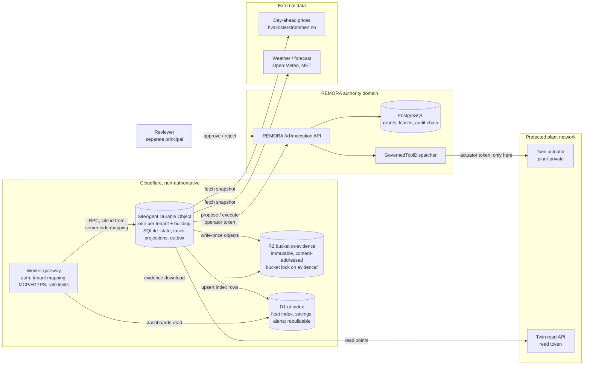
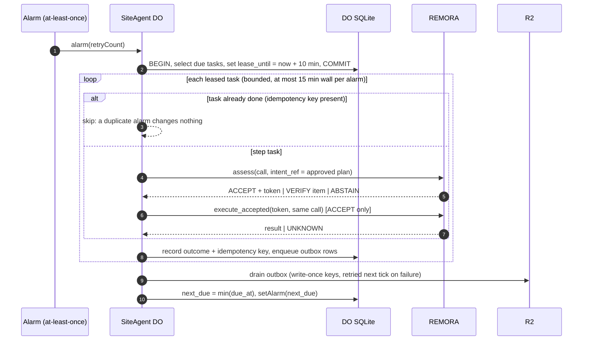
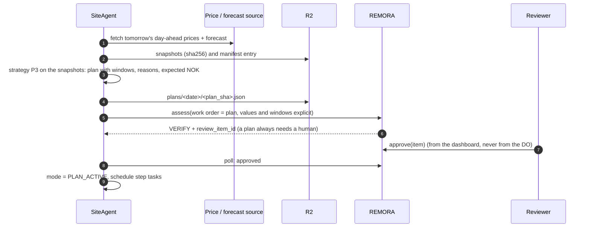
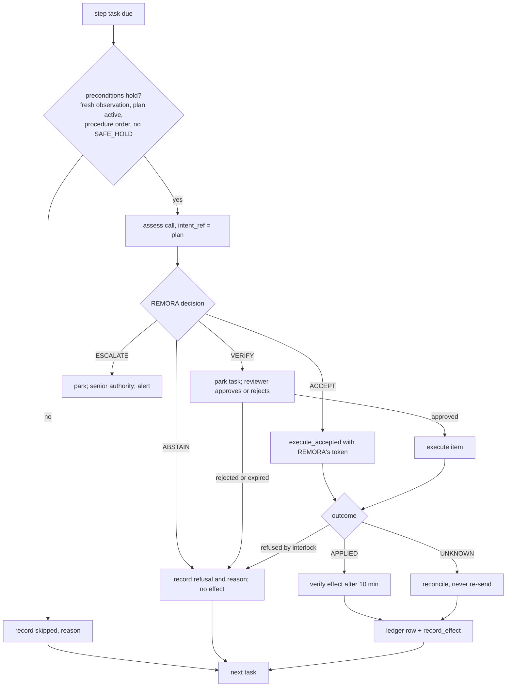
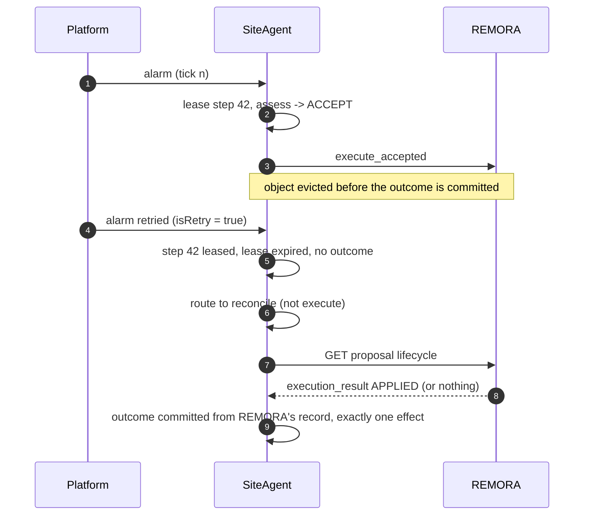
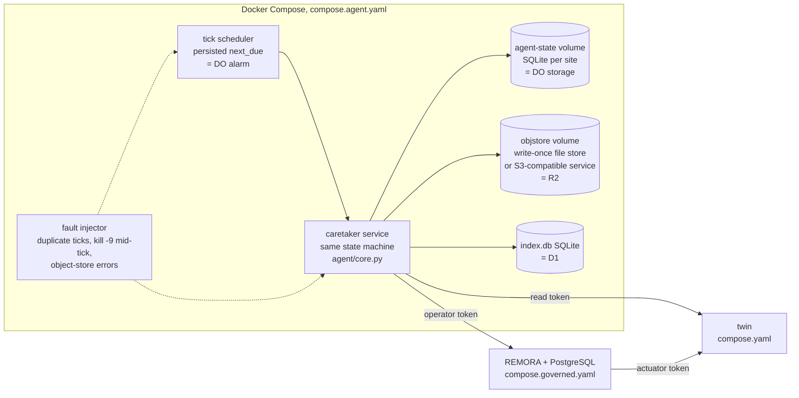
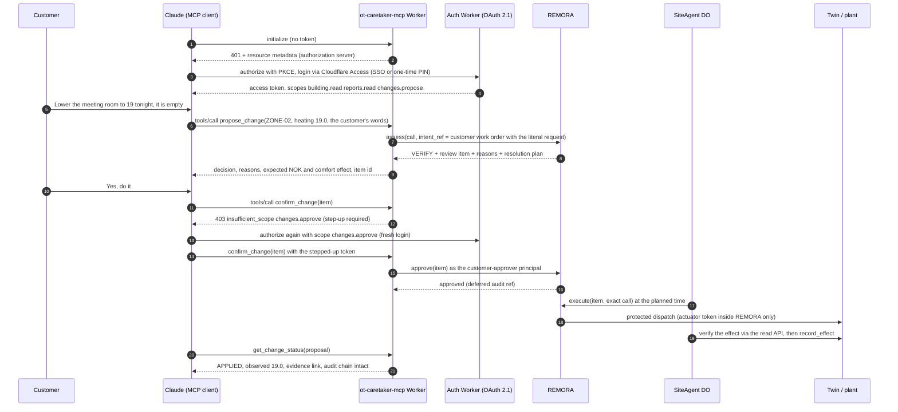

# Autonomous runtime on Cloudflare: Durable Objects, R2 and D1, with a Docker twin

- Document: `ARCH-OT-008`. Status: **design specification**, not yet implemented (OT-006/OT-008)
- Date: 2026-10-27
- Related:
  - SDD-OT-001 §2 (trust domains, INV-01..12), §7 (Cloudflare design), §11 (AT-14, AT-15)
  - ADR-004 (A/B/C), ADR-005 (data, savings, ledger), ADR-006 (strategies, plan approval), ADR-007 (plant, procedures)
- Platform facts below were checked against developers.cloudflare.com on 2026-10-27. Each one cited in §9 must be re-checked when this design is implemented.

## 1. Purpose

The digital caretaker runs for weeks, not seconds. It:
- observes the building every few minutes;
- refreshes forecasts and prices;
- plans a day once the day-ahead prices are published;
- waits hours for a human to approve the plan;
- executes plan steps every 15 minutes, verifies each effect, and keeps a full audit trail.

It must survive restarts, evictions, network failures and duplicate timer events without repeating a physical effect.

This document specifies how that long-running loop runs on **Durable Objects** (state and schedule), **R2** (immutable evidence) and **D1** (fleet index), with no agent framework such as LangGraph, and how **Docker** demonstrates the same behaviour offline.

## 2. Why no LangGraph is needed

| What an agent framework provides | What provides it here |
|---|---|
| A graph of steps | An explicit, versioned state machine in plain code (§4), small enough to review line by line |
| A checkpointer for durable state | The Durable Object's own SQLite database: transactional and colocated, so it survives eviction |
| A scheduler, sleep and resume | One Durable Object alarm per site, set to the earliest due task |
| Human-in-the-loop interrupts | REMORA's own review queue: VERIFY and ESCALATE create a review item, and the loop parks the task until the item is approved, rejected or expired |
| Retries | Bounded, idempotent tasks. External effects go only through REMORA, whose grants are single-use |
| Tool calling | Governed REMORA tools (signed ToolSpecs). The loop has no other effect path |

The decisive point is authority. A framework would add a second place where "what happens next" is decided. Here the loop only **proposes**; REMORA decides and dispatches. The state machine can therefore stay deterministic and boring, which is exactly what an OT loop should be. An LLM, if one is used later, is one optional proposer behind the same interface (D-04). It is never the scheduler and never the authority.

## 3. Architecture



### 3.1 Responsibilities and what each part must never do

| Component | Holds | Does | Never does |
|---|---|---|---|
| Worker gateway | Caller auth config, tenant → site mapping | Authenticates, maps the caller to `SiteAgent(tenant:building)`, serves dashboards from D1 and evidence from R2 | Decide, approve or dispatch; hold an actuator credential |
| `SiteAgent` DO | Loop state, task schedule, proposal projections, observation cache, outbox; the **operator** REMORA token (Worker secret) | Runs the state machine on alarms; proposes to REMORA; reads the plant; writes evidence | Hold the approver or actuator token; treat its own projection as authority; re-send an execute whose outcome is UNKNOWN |
| R2 `ot-evidence` | Snapshots, daily plans, decision-ledger chunks, REMORA evidence exports, run manifests | Keeps them write-once (content-addressed keys, bucket lock) | Get overwritten. A correction is a new object that references the old one |
| D1 `ot-index` | Query rows: sites, runs, decisions, savings, alerts | Lets an operator ask "what did the caretaker do last week and what did it save" | Act as a source of truth. Every row points at an R2 object or a REMORA proposal id and can be rebuilt from them |
| REMORA | Policy, grants, leases, audit chain | Decides ACCEPT / VERIFY / ABSTAIN / ESCALATE, dispatches through the protected callable | Run in the DO, or trust the DO's view of state |

## 4. The caretaker state machine

The loop is a set of **tasks** in the DO's SQLite table. Each task has a kind, a due time, a status and an idempotency key. The DO keeps exactly one alarm, set to the earliest due task. An alarm runs every due task as one bounded, idempotent step, then sets the next alarm.

```mermaid
stateDiagram-v2
  [*] --> IDLE
  IDLE --> OBSERVE: due observe (5 min)
  OBSERVE --> IDLE: points cached, anomalies -> ALERT
  IDLE --> REFRESH_INPUTS: due forecast (1 h) / prices (13.00 CET)
  REFRESH_INPUTS --> IDLE: snapshot written to R2 (sha256)
  IDLE --> PLAN: due daily plan (after prices published)
  PLAN --> AWAIT_PLAN_APPROVAL: plan proposed to REMORA (VERIFY)
  AWAIT_PLAN_APPROVAL --> PLAN_ACTIVE: approved
  AWAIT_PLAN_APPROVAL --> FALLBACK_SCHEDULE: rejected or expired
  PLAN_ACTIVE --> STEP: due plan step (15 min)
  STEP --> AWAIT_STEP_REVIEW: VERIFY / ESCALATE (off-plan)
  STEP --> DISPATCHED: ACCEPT -> execute_accepted
  STEP --> PLAN_ACTIVE: ABSTAIN (recorded, skipped)
  AWAIT_STEP_REVIEW --> DISPATCHED: approved -> execute
  AWAIT_STEP_REVIEW --> PLAN_ACTIVE: rejected / expired
  DISPATCHED --> VERIFY_EFFECT: result APPLIED
  DISPATCHED --> RECONCILE: outcome UNKNOWN (never re-sent)
  RECONCILE --> VERIFY_EFFECT: REMORA lifecycle + twin op log agree
  RECONCILE --> SAFE_HOLD: indeterminate
  VERIFY_EFFECT --> RECORD: observer reads the point (+10 min)
  RECORD --> PLAN_ACTIVE: ledger row + record_effect
  PLAN_ACTIVE --> IDLE: plan window ends
  FALLBACK_SCHEDULE --> IDLE: building keeps its own schedule (no writes)
  SAFE_HOLD --> IDLE: human resolves (resolve_unknown)
  state SAFE_HOLD {
    [*] --> no_new_writes
    no_new_writes: no new proposals for the affected point;<br/>alert raised; observation continues
  }
```



Rules the machine enforces:

1. **One effect path.** Only `STEP` and its review branch reach REMORA's execute endpoints. Every other state reads or writes evidence.
2. **UNKNOWN is terminal for automation.** An execute that times out goes to `RECONCILE`, which reads REMORA's lifecycle and the twin's operation log. It never sends the execute again (INV-05, INV-10).
3. **Fail to the building's own schedule.** With no approved plan, the caretaker writes nothing. The building's schedule (P0) runs, so the worst case of a caretaker fault is "no optimization", never "no heat".
4. **Procedures are task chains.** A multi-step change (ADR-007 PR-01..05) becomes a chain of `STEP` tasks with explicit preconditions. A step whose precondition fails is not proposed. One the plant's interlock refuses is recorded, and the chain stops.

### 4.1 Task catalogue

| Task | Cadence | Bounded work | Idempotency key |
|---|---|---|---|
| `observe` | 5 min | read datapoints (read token), cache them, check plausibility ranges (`docs/datapoints.md`) | `site:observe:<slot>` |
| `refresh_forecast` | 1 h | fetch the forecast, write a snapshot to R2 with its SHA-256 | `site:forecast:<hour>` |
| `refresh_prices` | daily 13:00 CET, retried to 15:00 | fetch tomorrow's day-ahead prices, snapshot them | `site:prices:<date>` |
| `plan_day` | after `refresh_prices` | run the strategy (ADR-006 P1–P3) on the snapshots; write the plan to R2; propose it to REMORA as a work order | `site:plan:<date>:<plan_sha>` |
| `poll_review` | 1 min while waiting, backing off to 10 min | read the review item / proposal state | `site:review:<item>` |
| `step` | per plan step (15 min) | one governed call: assess, then `execute_accepted` on ACCEPT, or park on VERIFY | `site:step:<plan_sha>:<step_no>` |
| `verify_effect` | dispatch + 10 min | observer read, `verify_effect`, `record_effect` | `site:effect:<proposal_id>` |
| `reconcile` | on UNKNOWN; then 5, 15, 60 min | read lifecycle and the twin op log; never execute | `site:reconcile:<proposal_id>` |
| `flush_ledger` | 00:15 daily | close the day's ledger chunk to R2; upsert D1 index rows | `site:ledger:<date>` |
| `savings_report` | weekly | counterfactual savings (ADR-005) over the verified week; to R2 and D1 | `site:savings:<iso_week>` |
| `watchdog` | 15 min | detect a stuck task (lease expired) or a stale observation; raise an alert | `site:watchdog:<slot>` |

### 4.2 One alarm tick, made safe for at-least-once delivery



Why this is safe when the alarm fires twice, or the object is evicted mid-tick:
- A completed task's idempotency key is committed together with its outcome, so a second run is a no-op.
- A lease that expired without an outcome means the tick died mid-task.
  - A **read** task is simply rerun.
  - A **step** task is sent to `reconcile`, never re-executed. REMORA would refuse a replay of the grant in any case, but the loop does not rely on that.
- R2 writes go through an outbox with content-addressed keys. Writing the same object twice is harmless; a lost write is retried on the next tick.
- If an alarm handler keeps failing, the platform's retries run out (about six). The handler therefore sets a fresh alarm itself before it gives up. The watchdog flags any task that is still overdue.

## 5. Storage design

### 5.1 Durable Object SQLite (per site)

```sql
CREATE TABLE agent_state (       -- exactly one row
  site_id TEXT PRIMARY KEY, mode TEXT NOT NULL,          -- IDLE|PLAN_ACTIVE|SAFE_HOLD|...
  active_plan_sha TEXT, plan_review_item TEXT,
  strategy TEXT NOT NULL, strategy_version TEXT NOT NULL,
  remora_commit TEXT NOT NULL, updated_at TEXT NOT NULL);
CREATE TABLE tasks (
  task_id TEXT PRIMARY KEY, kind TEXT NOT NULL, due_at INTEGER NOT NULL,
  status TEXT NOT NULL CHECK (status IN ('pending','leased','done','failed','parked')),
  lease_until INTEGER, attempts INTEGER NOT NULL DEFAULT 0,
  idempotency_key TEXT NOT NULL UNIQUE, payload TEXT NOT NULL, outcome TEXT);
CREATE INDEX tasks_due ON tasks(status, due_at);
CREATE TABLE proposals (         -- a projection of REMORA, never authority
  proposal_id TEXT PRIMARY KEY, task_id TEXT NOT NULL, tool TEXT NOT NULL,
  call_sha256 TEXT NOT NULL, decision TEXT, review_item_id TEXT,
  remora_state TEXT, effect_status TEXT, last_polled_at INTEGER);
CREATE TABLE observations (point_id TEXT PRIMARY KEY, value REAL, unit TEXT,
  sample_at INTEGER, quality TEXT);
CREATE TABLE outbox (key TEXT PRIMARY KEY, target TEXT CHECK (target IN ('r2','d1')),
  body BLOB NOT NULL, sha256 TEXT NOT NULL, created_at INTEGER NOT NULL);
CREATE TABLE journal (seq INTEGER PRIMARY KEY AUTOINCREMENT, at INTEGER NOT NULL,
  event TEXT NOT NULL, detail TEXT NOT NULL);           -- append-only, flushed to R2 daily
```

The SQLite-backed Durable Object stores up to 10 GB per object. A site uses
megabytes per year because the journal and ledger are flushed to R2 daily and
pruned locally after their R2 write is confirmed.

### 5.2 R2 layout (bucket `ot-evidence`)

```
evidence/<tenant>/<site>/
  snapshots/sha256/<digest>.json          price, forecast, weather (ot-exogenous-snapshot/v1)
  plans/<date>/<plan_sha>.json            the day plan as proposed, with inputs' digests
  ledger/<date>/<chunk_seq>.jsonl         decision-ledger rows (ADR-005 decision 4)
  remora/<proposal_id>/evidence.json      REMORA's evidence export, verbatim (hashed manifest)
  effects/<proposal_id>.json              observer envelope + record_effect result
  savings/<iso_week>.json                 counterfactual savings with inputs, seeds, scope
  manifests/<date>.json                   every object written that day, with SHA-256
runs/<run_id>/...                          A/B/C experiment bundles (ADR-004)
```

- Keys under `snapshots/` are content-addressed by SHA-256.
- Everything under `evidence/` is protected by a bucket-lock rule, for example
  `wrangler r2 bucket lock add ot-evidence --name evidence-retain --prefix evidence/ --retention-days 3650`.
  A bucket lock blocks overwrites and deletes for the retention period and takes
  precedence over lifecycle rules.
- The daily manifest is the index of the day. Its own SHA-256 goes into D1 and into the next day's manifest, so days form a hash chain.

### 5.3 D1 schema (database `ot-index`)

```sql
CREATE TABLE sites (site_id TEXT PRIMARY KEY, tenant TEXT NOT NULL, price_area TEXT NOT NULL,
  lat REAL NOT NULL, lon REAL NOT NULL, fictitious INTEGER NOT NULL, strategy TEXT NOT NULL);
CREATE TABLE decisions (proposal_id TEXT PRIMARY KEY, site_id TEXT NOT NULL, at TEXT NOT NULL,
  tool TEXT NOT NULL, decision TEXT NOT NULL, outcome TEXT, layer TEXT,
  effect_status TEXT, est_cost_delta_nok REAL, ledger_r2_key TEXT NOT NULL);
CREATE INDEX decisions_site_at ON decisions(site_id, at);
CREATE TABLE daily (site_id TEXT, date TEXT, energy_kwh REAL, cost_nok REAL,
  ref_cost_nok REAL, comfort_dh REAL, hazard_h REAL, manifest_sha256 TEXT NOT NULL,
  PRIMARY KEY (site_id, date));
CREATE TABLE alerts (alert_id TEXT PRIMARY KEY, site_id TEXT, at TEXT, kind TEXT,
  detail TEXT, resolved_at TEXT);
```

D1 is a single-threaded SQLite database of at most 10 GB. One fleet index is enough for a pilot. The design shards per tenant later if needed. Every D1 row is derived and carries the R2 key or proposal id it came from. `rebuild_index` recomputes D1 from the R2 manifests.

## 6. Key flows

### 6.1 Daily plan, from prices to approval



### 6.2 A plan step through REMORA's four outcomes



Whether REMORA can ACCEPT a step bound to an approved plan, without asking a
human again, is the open spike D-16 (ADR-006). Until it is settled, every step
goes down the VERIFY branch. That is safe and slow; the machine does not
change when ACCEPT becomes possible.

### 6.3 Eviction, duplicate alarm, outage



| Failure | Behaviour |
|---|---|
| DO evicted, or the platform restarts it | State is in SQLite. The next alarm resumes. Leased tasks are reconciled or rerun by kind |
| Alarm delivered twice | Idempotency keys make the second run a no-op |
| REMORA unreachable or unready | No step proposed. Reads continue. After 30 min the DO raises an alert; the building runs its own schedule |
| PostgreSQL down behind REMORA | REMORA answers 503. Same as above, no blind resend (PR #3, AT-11) |
| Price source down at 13:00 | Retry until 15:00, then fall back to P2 (no price shifting) for tomorrow, recorded in the plan |
| R2 write fails | The outbox keeps the object and the next tick retries. Nothing is acknowledged before its write is confirmed |
| D1 write fails | Retried; D1 can always be rebuilt from R2 |
| Review never answered | The item expires, the step is skipped, and an alert names the stale item |
| Clock | Grant and lease expiry use REMORA's clock. The DO's clock only schedules |

## 7. Security and custody

- **Tokens.**
  - The DO holds only the REMORA **operator** token, as a Worker secret, and the twin **read** token.
  - The approver token lives with humans.
  - The actuator token lives only in REMORA's dispatcher (INV-01, INV-02).
  - A compromised DO can propose; it cannot approve or actuate.
- **Site identity** comes from the gateway's server-side mapping (`idFromName(tenant + ":" + building)`), never from a client-chosen name (INV-09).
- **R2 and D1 are evidence and index, never authority.** A forged D1 row changes no decision. A forged R2 object fails its SHA-256 against the manifest chain and against REMORA's own chain.
- **Untrusted code** (federation adapters, ADR-004) never runs in the SiteAgent's Worker. Miniflare is not a sandbox for untrusted code.

## 8. Deployment specification

### 8.1 `worker/wrangler.jsonc` (to be validated with Wrangler at implementation)

```jsonc
{
  "name": "ot-caretaker",
  "main": "src/index.ts",            // or a Python Worker entry (D-20)
  "compatibility_date": "2026-10-27",
  "durable_objects": {
    "bindings": [{ "name": "SITE_AGENT", "class_name": "SiteAgent" }]
  },
  "migrations": [{ "tag": "v1", "new_sqlite_classes": ["SiteAgent"] }],
  "r2_buckets": [{ "binding": "EVIDENCE", "bucket_name": "ot-evidence" }],
  "d1_databases": [{ "binding": "INDEX", "database_name": "ot-index", "database_id": "<set per env>" }],
  "limits": { "cpu_ms": 30000 },
  "vars": {
    "SITE_TIMEZONE": "Europe/Oslo",
    "OBSERVE_EVERY_S": "300",
    "STEP_EVERY_S": "900",
    "PRICE_FETCH_LOCAL": "13:00",
    "REMORA_URL": "https://remora.<private>"   // reached through Tunnel / private routing
  },
  // Secrets (wrangler secret put): REMORA_OPERATOR_TOKEN, TWIN_READ_TOKEN.
  // Never: approver or actuator tokens.
  "env": {
    "staging": { "vars": { "REMORA_URL": "https://remora-staging.<private>" } }
  }
}
```

### 8.2 Provisioning steps

1. `wrangler r2 bucket create ot-evidence`, then add the bucket-lock rule for `evidence/` (§5.2).
2. `wrangler d1 create ot-index`, then apply the §5.3 schema as a migration.
3. `wrangler secret put REMORA_OPERATOR_TOKEN` and `TWIN_READ_TOKEN` (per environment).
4. Provide private reachability for REMORA and the twin's read API:
   - a Cloudflare Tunnel to the Docker host for staging; or
   - Cloudflare Containers for REMORA (SDD OT-009) once their runtime semantics are measured.
5. `wrangler deploy --env staging`. Smoke test:
   - an observe tick writes a manifest;
   - an injected duplicate alarm writes nothing new;
   - a plan reaches REMORA as VERIFY.

## 9. Platform facts this design depends on

Checked against developers.cloudflare.com on 2026-10-27. Re-check each one at implementation.

| Fact | Used for |
|---|---|
| `alarm()` has at-least-once execution, retried with exponential backoff from 2 s for up to six retries; one alarm per object | idempotent ticks; re-arm before retries run out |
| Durable Object alarm handlers have a 15-minute wall-time limit; RPC/HTTP calls are unlimited while connected | bounded tick work |
| Workers CPU time defaults to 30 s, configurable up to 5 min on Workers Paid | strategy computation per tick; heavy simulation stays in REMORA or Docker |
| An idle, non-hibernating Durable Object is evicted after 70–140 s; pending I/O keeps it alive up to 15 min per operation | state lives in SQLite, never in memory |
| SQLite-backed Durable Objects: up to 10 GB per object, created with `new_sqlite_classes` | per-site state |
| D1: up to 10 GB per database (not raisable), single-threaded | fleet index, rebuildable, sharded per tenant later |
| R2 bucket locks prevent overwrite and deletion for a period or indefinitely, per prefix, and take precedence over lifecycle rules | immutable evidence |
| Workflows offer durable steps with unlimited wall time per step | an alternative for long procedures (§11) |

## 10. The Docker equivalent

The same loop runs offline in Docker so that every behaviour above can be demonstrated, tested and reproduced without a Cloudflare account (SDD G3, AT-14 and AT-15 parity).



| Cloudflare | Docker | Parity note |
|---|---|---|
| `SiteAgent` DO, one per site | one `caretaker` process per site, holding an exclusive file lock on its SQLite file | the lock gives the DO's single-writer guarantee on one host |
| DO SQLite | SQLite file on a volume | the same schema (§5.1) |
| Alarm (at-least-once, retries) | scheduler loop with persisted `next_due`. The fault injector replays ticks and kills mid-tick | duplicates are produced on purpose, so idempotency is tested rather than assumed |
| R2 with bucket lock | write-once object store: a file adapter that refuses to overwrite, or an S3-compatible service with object lock | the same keys (§5.2) |
| D1 | `index.db` SQLite | the same schema (§5.3); rebuild from objects |
| Worker secrets | `.env` (gitignored), injected only into `caretaker` | the same custody: operator and read tokens only |
| Tunnel / private routing | Docker networks `authority` and `observe` | `caretaker` never joins `plant-private` |

**One implementation of the loop.** The state machine, task catalogue and strategies live in one pure module, `agent/core.py`, with ports:

```
Storage     task table, state, outbox, journal  (DO SQLite | SQLite file)
Scheduler   set_next(due)                       (setAlarm | persisted next_due)
ObjectStore put_once(key, bytes) / get          (R2 | file or S3)
Index       upsert(table, row)                  (D1 | SQLite)
Remora      assess / execute_accepted / execute / lifecycle / record_effect  (remora.sdk)
Plant       read points                         (twin read API)
Clock       now()                               (platform clock | virtual clock in tests)
```

Two options carry the same core to Cloudflare (D-20):
- **(a) Python Workers.** Cloudflare documents Durable Object classes in Python, so the identical core runs in both. Maturity and package limits must be verified first.
- **(b) TypeScript DO adapter.** It must reproduce golden traces that the Python core generates. The parity test runs the same seed and the same virtual clock through both and requires identical task logs and REMORA call sequences.

Either way, AT-14 (eviction and alarm replay create no new effect) and AT-15 (same requests give the same authoritative outcome) are written once against the ports and run against both adapters.

Docker demonstrates the same behaviour, with these limits:
- **Shown:** a long-running loop, durable resume after a crash, at-least-once ticks made safe, the review wait, the UNKNOWN reconcile, write-once evidence, a rebuildable index, and the custody boundary.
- **Not shown:** Cloudflare's own hosted semantics. That needs Gate C hosted tests (SDD §13). A green Docker run is never reported as hosted verification.

## 11. Alternatives considered

| Option | Why not, for now |
|---|---|
| LangGraph or a similar agent framework | It adds a second decision layer and a second checkpoint store beside REMORA. The loop needs a scheduler and durable state, which DO SQLite and alarms give without a dependency (§2) |
| Cloudflare Workflows for the whole loop | A good fit for one long procedure (durable steps, sleeps, unlimited wall time per step). The caretaker is a per-site singleton with interactive state and many small periodic tasks, which a DO models directly. Workflows remain an option for procedures PR-01..05, started by the DO (D-21) |
| D1 as the agent's state | One shared database for every site serializes them all, and puts operational state where analytics also writes. Per-site state belongs in the per-site DO |
| KV for state | Eventually consistent; unsuitable for a task lease |

## 12. Owner decisions

| ID | Decision | Recommended default |
|---|---|---|
| D-20 | Language of the Cloudflare adapter | (a) Python Workers if a spike confirms the DO API and package support; otherwise (b) TypeScript with golden-trace parity |
| D-21 | Workflows for long procedures | Not in v1. Revisit when a procedure's steps exceed one tick |
| D-22 | R2 retention for evidence | 10 years on `evidence/`; experiment `runs/` without a lock |
| D-23 | How the reviewer approves | A dashboard behind Cloudflare Access calling REMORA with the reviewer's own token; never through the DO |
| D-24 | Customer identity at REMORA | v1: two stored REMORA tokens per tenant (agent, approver). Later: REMORA verifies a signed per-request identity assertion (upstream change) |
| D-25 | Who may approve high-tier changes from MCP | Only principals whose role meets REMORA's risk profile; a customer without it gets the required role back and the change waits |

## 13. Customer MCP server (planned after the testbed is validated)

### 13.1 Purpose and the one rule

A customer connects Claude, or any MCP client, to the building. Through it the customer can:

- read reports and the decision trail;
- receive suggested measures, each with its expected NOK and comfort effect;
- ask in natural language for a change.

**The MCP server has no path to the plant except REMORA.** It holds no actuator credential and has no route to the plant network. It never calls REMORA's execute endpoints. Its only state-changing calls are:

- `assess`, as the customer's proposing principal;
- `approve` and `reject`, as the customer's separate approving principal, after a step-up authorization.

Dispatch happens later, in the caretaker DO, through REMORA's protected path. The effect is then verified and its evidence recorded (§6.2).

The HTTP and tool contract is `contracts/mcp/ot-caretaker-mcp-v1.openapi.json`.



### 13.2 Tools

| Tool | Scope | REMORA call | Effect on the plant |
|---|---|---|---|
| `get_building_status` | `building.read` | none (cached caretaker projection; the twin read token stays in the DO) | none |
| `get_datapoints` | `building.read` | none | none |
| `get_prices_and_forecast` | `building.read` | none (R2 snapshots with SHA-256) | none |
| `get_report` | `reports.read` | none (D1 index + R2 objects) | none |
| `get_decision` | `reports.read` | `GET` lifecycle and evidence | none |
| `list_recommendations` | `reports.read` | none (caretaker strategy output, each with expected NOK, comfort, confidence and evidence refs) | none |
| `propose_change` | `changes.propose` | `assess` as principal `customer-agent:<tenant>` (role operator) | none: it creates a proposal and REMORA decides |
| `propose_procedure` | `changes.propose` | `assess` of a plan work order (ADR-007 PR-01..05) | none |
| `confirm_change` | `changes.approve` (step-up) | `approve` as principal `customer-approver:<tenant>` (role per risk tier) | none directly; the caretaker executes later through REMORA |
| `reject_change` | `changes.approve` | `reject` with a reason | none |
| `get_change_status` | `reports.read` | `GET` proposal and lifecycle, plus effect verification | none |

No tool takes a valve position, a compressor command or a raw actuator write. Natural language is the client's job; the server takes only structured arguments.

- It validates those arguments against the same catalogue (`docs/datapoints.md`) that REMORA's signed ToolSpecs come from.
- It records the customer's own words as the work order text, so REMORA's argument grounding works honestly. "Set it to 19" grounds the value 19.0. "A bit warmer" does not, so REMORA asks for confirmation of the value (`confirm_argument_values`).

### 13.3 Identity and custody

- **OAuth 2.1 is mandatory.** No tool answers without a valid token for the `https://mcp.<domain>/mcp` resource.
  - The authorization server is a separate Worker (Workers OAuth Provider, split API), with Cloudflare Access as the identity provider.
  - The MCP Worker validates each token over a Service Binding.
- **Two REMORA principals per tenant,** so the agent that proposes is never the identity that approves (INV-06):
  - `customer-agent:<tenant>` (operator) proposes;
  - `customer-approver:<tenant>` approves, and is used only after a step-up authorization the person completes in the browser.
- **The mapping from OAuth subject to tenant and principal is server-side** (the auth Worker's grant props). It never comes from a tool argument.
  - In v1 the MCP Worker holds the two REMORA tokens per tenant as secrets.
  - Removing those stored tokens needs a REMORA that accepts a signed identity assertion per request. That is an upstream question (D-24).
- **The approver's role must satisfy REMORA's risk profile.** A high-tier change needs a `domain_expert`, which a customer may not be. In that case `confirm_change` answers with the role REMORA requires, and the change waits for that person.

### 13.4 Setup on Cloudflare

1. **Access as identity provider.**
   - In Cloudflare One, create a Zero Trust organization and configure an identity provider (or one-time PIN).
   - Add an Access for SaaS application for the MCP server.
   - Copy its client id, client secret, and its authorization, token and key endpoints.
2. **Auth Worker** `ot-caretaker-auth`, built on `@cloudflare/workers-oauth-provider` v1 `OAuthAuthorizationServer`:
   - `issuer: https://auth.<domain>`;
   - `resources: ["https://mcp.<domain>/mcp"]`;
   - `scopesSupported: ["building.read", "reports.read", "changes.propose", "changes.approve"]`;
   - KV namespace `OAUTH_KV`;
   - secrets `ACCESS_CLIENT_ID`, `ACCESS_CLIENT_SECRET`, `ACCESS_TOKEN_URL`, `ACCESS_AUTHORIZATION_URL`, `ACCESS_JWKS_URL` and `COOKIE_ENCRYPTION_KEY` (`openssl rand -hex 32`);
   - a consent screen that names each scope in plain language. `changes.approve` is never granted together with the others in one consent. It requires a fresh sign-in each time (step-up).
3. **MCP Worker** `ot-caretaker-mcp`, an `OAuthResourceServer`:
   - `resourceMetadata.resource: https://mcp.<domain>/mcp`, `authorization_servers: ["https://auth.<domain>"]`;
   - `requiredScopes: ["building.read"]`; each tool checks its own scope and otherwise answers `insufficientScope`;
   - Service Bindings: `AUTH_SERVER` (token validation) and `SITE_AGENT` (the caretaker DO namespace, for read projections);
   - read-only use of the R2 and D1 bindings `EVIDENCE` and `INDEX`;
   - secrets `REMORA_TOKEN_AGENT_<TENANT>`, `REMORA_TOKEN_APPROVER_<TENANT>` and `REMORA_URL`;
   - **no** actuator, control or twin write credential.
4. **Network.**
   - REMORA is reachable only through a Tunnel or a private route.
   - The MCP Worker may call REMORA's assess, approve, reject and read routes and nothing else.
   - A path allowlist in the Worker refuses `execute`, `execute-accepted` and `limits/resolve`, and a structural test pins it.
5. **Connect a client.**
   - Add `https://mcp.<domain>/mcp` as a remote MCP server in Claude or another client.
   - The client finds the authorization server from the 401 response's resource metadata and runs the OAuth flow.
   - The customer signs in through Access.
6. **Smoke test:**
   - an unauthenticated call is refused (401);
   - `get_report` works with `reports.read`;
   - `propose_change` returns REMORA's decision and creates no effect;
   - `confirm_change` without step-up returns 403 `insufficient_scope`;
   - with step-up, REMORA records the approval by the approver principal;
   - the caretaker executes and the effect is verified.

**Docker equivalent.** An `mcp` service runs the same tool handlers over Streamable HTTP. It has:

- a local OIDC provider, or a static dev token issuer that refuses non-loopback clients;
- the same two REMORA principals;
- the same path allowlist.

It demonstrates the identity split and the propose → confirm → REMORA-executes flow. As with everything Docker shows, it is not a hosted-security claim.

## 14. Acceptance criteria (when implemented)

- **AT-14:** kill the caretaker mid-tick (Docker) or evict the DO (Miniflare), and replay the alarm. Expected:
  - the twin's `state_revision` changes only by the effects REMORA records;
  - every leased step ends `done` (from REMORA's record) or `parked`;
  - nothing is sent twice.
- **AT-15:** the same seed, episode and virtual clock run through the Docker and Workers adapters give identical task logs, REMORA call sequences and outcomes.
- **Evidence:** the day's R2 manifest chain verifies from day 1. D1 rebuilt from R2 equals the live D1.
- **Custody:** a structural test finds no approver or actuator token in the Worker config, its secrets list or the `caretaker` service.
- **MCP:**
  - every tool refuses a call without a token, and a call with the wrong scope;
  - `confirm_change` needs step-up;
  - the path allowlist refuses REMORA's execute routes;
  - no MCP tool changes the twin's `state_revision` by itself;
  - an approved change takes effect only through the caretaker's governed dispatch.
